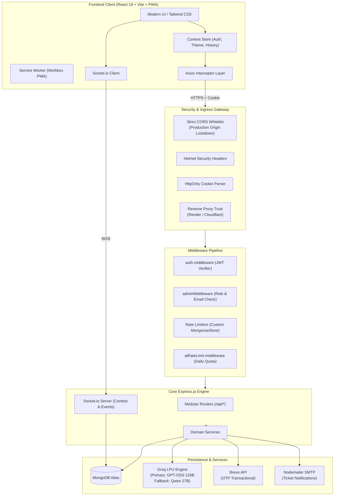
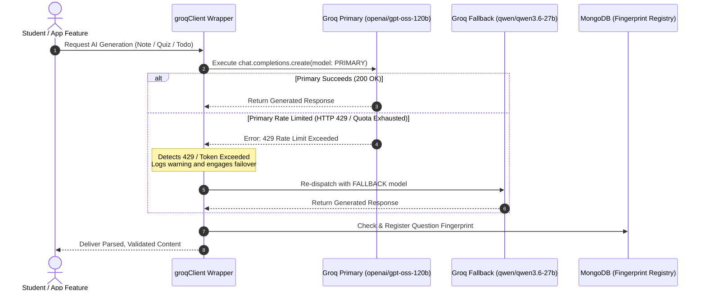
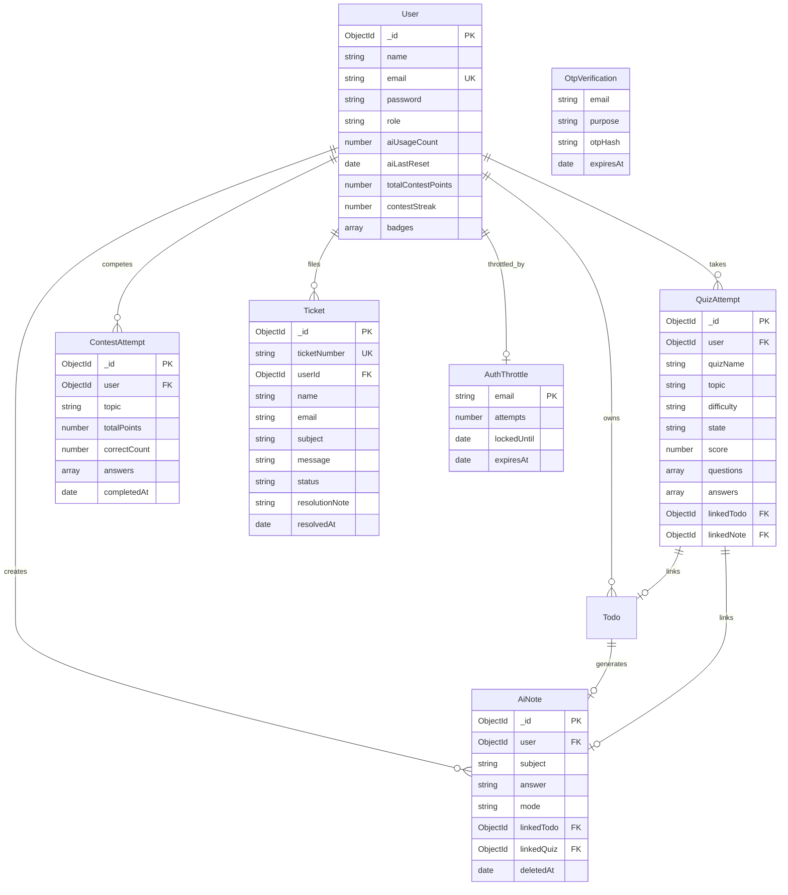

# 🚀 StudexaAI — Intelligent Student Learning & Assessment Platform

<div align="center">

[](https://studexaai.vercel.app)
[](/)
[](/)
[](/)
[](/)
[](/)

**A fullstack, AI-driven educational ecosystem that empowers students through automated study notes, adaptive quizzes, cognitive practice modules, gamified contests, and seamless academic workflow management.**

🌐 **Live Application**: [studexaai.vercel.app](https://studexaai.vercel.app) *(Live Application)*

</div>

---

## 📌 Project Overview

**StudexaAI** is an engineering-first educational platform designed to eliminate cognitive friction in academic learning and competitive exam preparation. Built with modern fullstack web standards and high-throughput LLM reasoning via Groq LPUs, the platform centralizes study planning, automated concept synthesis, repeat-proof practice rounds, and real-time multiplayer contests into a cohesive daily loop: **Plan → Learn → Practice → Review**.

```
┌────────────────────────────────────────────────────────────────────────────────┐
│                                STUDEXA AI CORE                                 │
│                                                                                │
│   🤖 AI Notes & Todos    ⚡ Practice Engine       🏆 Live Contests             │
│   • Short & Detailed     • Aptitude, Logical &    • DSA, OOPs & SQL tracks     │
│   • Auto-Todo to Note      Verbal Reasoning       • Real-time Socket.io state  │
│   • Dynamic Regenerate   • Deduplicated banks     • Weighted speed scoring     │
│                                                                                │
│   🎫 Helpdesk System     🛡️ Enterprise Security   📱 Progressive Web App       │
│   • Dual guest/auth      • JWT HttpOnly Cookies   • Offline Workbox caching    │
│   • HTML Email dispatch  • Brute-force throttle   • Installable on Desktop/iOS │
└────────────────────────────────────────────────────────────────────────────────┘
```

---

## ✨ Key Features & Engineering Highlights

### 🗒️ Intelligent AI Study Notes
- **Dual Synthesis Modes**: Generates structured, exam-oriented bullet points (**Short Mode**) or in-depth technical concept breakdowns with analogies and code snippets (**Detailed Mode**).
- **Contextual Regeneration**: Prompts the LLM with elevated sampling temperature to rewrite or offer fresh perspectives on existing study material.
- **Todo-to-Note Synthesis**: Converts high-level academic tasks into complete study notes with a single click.
- **Client History Drawer**: Fast client-side cached sidebar displaying indexed past study guides.

### 🧪 Cognitive Practice & Placement Tracks
- **Quantitative Aptitude**: Arithmetic, Ratios, Speed & Distance, Probability, and Data Interpretation tailored to campus placement rounds.
- **Logical Reasoning**: Deductive reasoning, arrangement puzzles, and pattern traps designed to test analytical agility.
- **Verbal Reasoning**: Reading comprehension, contextual inference, sentence correction, and vocabulary cloze tests.
- **Question Deduplication Engine**: Every AI-generated question is hashed with SHA-256 and stored in a TTL fingerprint registry (`QuestionFingerprint`) with a 180-day retention window, guaranteeing zero repeated questions across sessions.

### 🏆 Gamified Real-Time Contests
- **Domain Tracks**: Data Structures & Algorithms (DSA), Object-Oriented Programming (OOPs), and Database Management Systems (SQL).
- **Speed-Weighted Scoring**: Real-time evaluation based on response correctness combined with decay curve algorithms that reward rapid decision-making.
- **Real-Time State Synchronization**: Socket.io integration powers live participant updates, streak counters, and global leaderboards.
- **Milestone Badges**: Dynamic evaluation of consecutive participation streaks and cumulative points.

### ✅ Academic Task Board & Planner
- **AI Task Decomposition**: Deconstructs ambitious study goals into actionable sub-tasks.
- **Automated Lifecycle Maintenance**: Background cron routines gracefully manage overdue task items without user intervention.

### 🎫 Dual-Workflow Support Helpdesk
- **Guest & Authenticated Channels**: Allows visitors to submit inquiries frictionlessly, while authenticated users manage tickets directly within their dashboard.
- **Automatic Identity Claiming**: Guest tickets matching a verified email address automatically link to the student profile upon registration.
- **Admin Review & Email Notifications**: Admin resolution notes trigger automated, responsive HTML notification emails directly to the student.

### 📱 Progressive Web App (PWA)
- **Installable Experience**: Meets Web App Manifest specifications for native installation on macOS, Windows, Android, and iOS.
- **Offline Resilience**: Workbox runtime caching strategies ensure core application assets remain functional under intermittent connectivity.
- **Auto-Update Prompt**: In-app toast banner alerting students when a new service worker release is available.

---

## 🏗️ System Architecture

StudexaAI is architected as an ESM-native monorepo dividing concerns cleanly between a hardened Express.js REST API and a high-performance React 19 SPA powered by Vite and TailwindCSS v4.



---

## 🤖 Intelligent AI Engine & Fallback Pipeline

StudexaAI incorporates an automated resilience pipeline to maintain 99.9% availability for AI operations on Groq's inference infrastructure:



| Role | Model Identifier | Architecture | Context Window | Engineering Purpose |
|---|---|---|---|---|
| **Primary** | `openai/gpt-oss-120b` | 120B Open-Weights | 131,072 tokens | Flagship reasoning, multi-turn comprehension, strict structured JSON compliance. |
| **Fallback** | `qwen/qwen3.6-27b` | 27B Instruction | 131,072 tokens | High-speed automatic failover ensuring uninterrupted study sessions during quota drops. |

---

## 🛠️ Tech Stack Breakdown

### Frontend Architecture
| Technology | Version | Purpose in StudexaAI |
|---|---|---|
| **React** | `19.2.0` | Core reactive UI library with concurrent rendering and modern hook patterns. |
| **Vite** | `7.2.4` | Next-generation bundler enabling instant hot-module replacement and optimized builds. |
| **TailwindCSS** | `4.1.18` | Utility-first styling via `@tailwindcss/vite` with custom design tokens and dark/light modes. |
| **Framer Motion** | `12.24.0` | Production micro-animations, smooth layout transitions, and page state entrances. |
| **VitePWA / Workbox** | `2.0.0` | Progressive Web App integration, asset precaching, and service worker update lifecycle. |
| **Lucide Icons** | `0.562.0` | Clean, accessible vector iconography across all dashboard and landing views. |
| **Chart.js** | `4.5.1` | Visual analytics for quiz scores, contest rankings, and study time distribution. |
| **Socket.io Client** | `4.8.3` | Low-latency duplex communication for live contest states and leaderboards. |

### Backend Architecture
| Technology | Version | Purpose in StudexaAI |
|---|---|---|
| **Node.js** | `>= 20.0` | High-throughput JavaScript runtime with full native ECMAScript Modules (ESM). |
| **Express.js** | `5.2.1` | REST API framework handling modular routing, security filters, and controllers. |
| **Socket.io** | `4.8.3` | Real-time WebSocket gateway managing live multiplayer contest room lifecycles. |
| **Groq SDK** | `0.37.0` | Low-latency inference client interfacing with Groq LPUs for rapid generative completion. |
| **Nodemailer** | `10.3.1` | SMTP transport client formatting and dispatching support ticket resolution alerts. |
| **Axios** | `1.13.2` | Outbound HTTP client for transactional Brevo API email delivery. |

### Database & Storage
| Technology | Version | Purpose in StudexaAI |
|---|---|---|
| **MongoDB Atlas** | Cloud | Distributed NoSQL document database hosting users, tasks, notes, quizzes, and contests. |
| **Mongoose** | `9.1.1` | Strict schema definition, validation hooks, compound indexes, and lean query projections. |
| **TTL Indexes** | Native | Automated deletion of expired OTP codes (`OtpVerification`) and throttles (`AuthThrottle`). |

### Security & Hardening Architecture
| Security Layer | Implementation Details |
|---|---|
| **CORS Lockdown** | Strict origin whitelisting function validating requests against `FRONTEND_URL` / `CLIENT_URL`. |
| **Session Protection** | Authenticated tokens stored in signed, HttpOnly, SameSite cookies to mitigate XSS vectors. |
| **Brute-Force Guard** | `AuthThrottle` model tracking failed attempts; automatically locks email accounts for 10 minutes after 7 failures. |
| **Isolated Rate Limiting** | Custom `MongooseStore` factory preventing store reuse collisions across separate endpoint limiters. |
| **Dual-Key Admin Auth** | Admin endpoints enforce a compound check: verified JWT `role === "admin"` AND server `ADMIN_EMAIL` match. |
| **Data Projection Safety** | Passwords and sensitive operational flags enforce `{ select: false }` across Mongoose schemas. |

---

## 🗄️ Database Schemas & Data Model



---

## 👤 Creator & Author

**StudexaAI** was conceptualized, architected, and engineered solely by:

| Role | Author | Responsibility |
|---|---|---|
| **Sole Creator & Lead Architect** | **Amaan Mujawar** | End-to-end System Design, Fullstack Architecture, AI Resilience, Security & Core Engineering |

---

## 📄 License & Copyright

Copyright © 2026 Amaan Mujawar. All Rights Reserved. This repository is publicly visible for portfolio and academic evaluation purposes only. Unauthorized copying, modification, distribution, or deployment is strictly prohibited.
