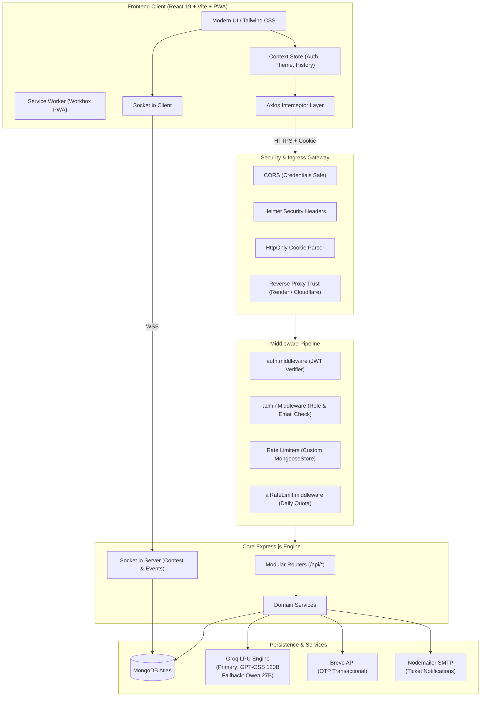
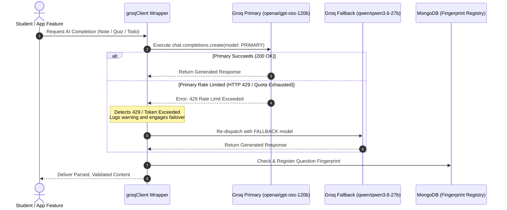
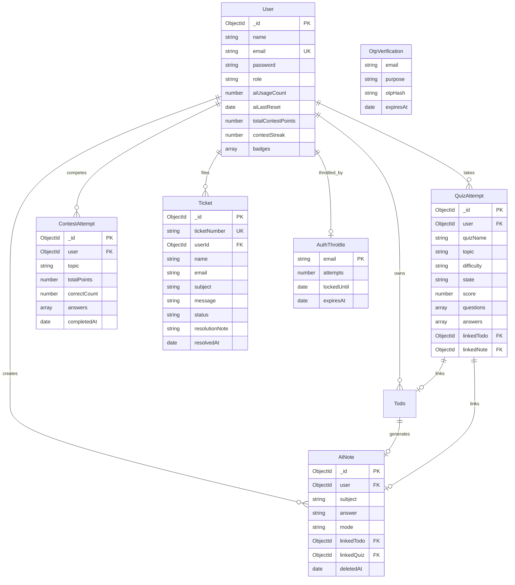
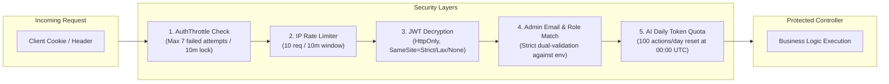

# 🚀 StudexaAI — Intelligent Student Learning & Assessment Platform

<div align="center">

[](/)
[](/)
[](/)
[](/)
[](/)

**A next-generation, AI-driven educational ecosystem that empowers students through automated study notes, adaptive quizzes, cognitive practice modules, gamified contests, and seamless academic workflow management.**

[Key Features](#-core-features) • [Architecture](#-system-architecture) • [AI & Fallback](#-intelligent-ai-engine--fallback-pipeline) • [Database Schemas](#-database-schemas--relationships) • [API Reference](#-complete-api-reference) • [Setup Guide](#-local-development-setup) • [Deployment](#-production-deployment)

</div>

---

## 📌 Executive Summary

**StudexaAI** is an all-in-one educational platform engineered to eliminate cognitive friction in academic learning and competitive exam preparation. By integrating high-throughput LLM reasoning via Groq with fullstack reactive interfaces and real-time Socket communication, StudexaAI bridges the gap between passive content consumption and active, retention-driven study.

```
┌────────────────────────────────────────────────────────────────────────────────┐
│                                STUDEXA AI CORE                                 │
│                                                                                │
│   🤖 AI Notes & Todos    ⚡ Practice Engine       🏆 Live Contests             │
│   • Short & Detailed     • Aptitude, Logical &    • DSA, OOPs & SQL tracks     │
│   • Auto-Todo to Note      Verbal Reasoning       • Real-time Socket.io state  │
│   • Dynamic Regenerate   • Deduplicated banks     • Weighted speed scoring     │
│                                                                                │
│   🎫 Helpdesk System     🛡️ Enterprise Security   📱 Progressive Web App       │
│   • Dual guest/auth      • JWT HttpOnly Cookies   • Offline Workbox caching    │
│   • HTML Email dispatch  • Brute-force throttle   • Installable on Desktop/iOS │
└────────────────────────────────────────────────────────────────────────────────┘
```

---

## 🏗️ System Architecture

StudexaAI is architected as an ESM-native monorepo dividing concerns cleanly between a hardened Express.js REST API and a high-performance React 19 SPA powered by Vite and TailwindCSS v4.



---

## ✨ Core Features

### 🗒️ Intelligent AI Notes Generator
* **Dual Level Modes**: Generate concise, exam-oriented bullet points (**Short**) or deep comprehensive concept breakdowns with code snippets and real-world analogies (**Detailed**).
* **One-Click Regeneration**: Intelligently restructures and freshens existing notes with contextual temperature adaptation.
* **Todo Integration**: Directly synthesize study guides from individual task items in your task board.
* **History Drawer**: Fast client-side cached sidebar displaying indexed past generated notes.

### 🧪 Adaptive AI Quiz & Practice Tracks
* **AI Quiz Engine**: On-demand quiz generation across any custom user prompt with 4 options, exact indices, and thorough rationale explanations.
* **Specialized Placement Tracks**: Pre-configured reasoning tracks designed to mimic modern technical placement screening rounds:
  * **Quantitative Aptitude**: Arithmetic, Ratios, Speed & Distance, Probability, and Data Interpretation.
  * **Logical Reasoning**: Deductive logic, arrangements, pattern traps, and syllogisms.
  * **Verbal Reasoning**: Reading comprehension, critical inference, and contextual cloze tests.
* **Fingerprint Deduplication**: Every generated question is hashed and cross-referenced in `QuestionFingerprint` with a 180-day TTL to guarantee users never receive duplicate questions across sessions.

### 🏆 Gamified Real-Time Contests
* **Topic Arenas**: DSA, Object-Oriented Programming (OOPs), and Database Management / SQL.
* **Speed-Weighted Scoring**: Evaluates answers with real-time decay curves rewarding both accuracy and sub-second decision speed.
* **Dynamic Badges & Streaks**: Auto-calculates consecutive daily contest streaks and awards milestone badges.
* **Live Leaderboard**: Real-time aggregated leaderboard queryable globally or by topic.

### ✅ Task Board & Study Planner
* **AI Task Decomposition**: Breaks high-level academic objectives (e.g., *"Master Dynamic Programming in 3 weeks"*) into actionable, granular sub-tasks.
* **Auto-Completion & Expiry**: Automated background cron routines to transition overdue task items gracefully.

### 🎫 Support Helpdesk & Dual Workflow
* **Public & Authenticated Channels**: Guests can submit issues without authentication; authenticated users can track statuses directly from their dashboard.
* **Auto-Claim on Sign-in**: Guest tickets matching a user's verified email are automatically linked to their profile upon registration or authentication.
* **Admin Resolution Pipeline**: Resolving tickets triggers rich, custom HTML notification emails with review notes directly to the student.

### 📱 Progressive Web App (PWA)
* **Installable Application**: Configured with Web App Manifest standards for direct installation on macOS, Windows, Android, and iOS.
* **Offline Resilience**: Workbox-powered caching strategies for static bundles and assets.
* **Auto-Update Notifications**: In-app toast banner alerting students when a new application release is available.

---

## 🤖 Intelligent AI Engine & Fallback Pipeline

StudexaAI implements an enterprise-grade AI resilience architecture to ensure zero student downtime even under strict API rate limits or quota drops.



### Current Model Specification

| Role | Model Identifier | Parameter Scale | Context Window | Characteristics |
|---|---|---|---|---|
| **Primary** | `openai/gpt-oss-120b` | 120 Billion | 131,072 tokens | State-of-the-art open-weights reasoning, multi-turn comprehension, strict JSON adherence. |
| **Fallback** | `qwen/qwen3.6-27b` | 27 Billion | 131,072 tokens | High-speed instruction following and structured output generation when primary rate limit is hit. |

> [!NOTE]
> Historical models including `llama-3.3-70b-versatile` (decommissioned August 2026 for free tier), `llama-4-scout-17b`, and `qwen-qwq-32b` have been systematically retired to ensure compliance with the latest active provider infrastructure.

---

## 🗄️ Database Schemas & Relationships

StudexaAI runs on MongoDB using Mongoose with indexing, compound keys, TTL collections, and data integrity constraints.



---

## 📁 Repository Directory Structure

```
StudexaAI-Platform-main/
│
├── .gitignore                    # Monorepo-level git exclusions
├── README.md                     # Centralized technical documentation
│
├── backend/                      # Node.js + Express REST API (ESM)
│   ├── .env.example              # Comprehensive environment configuration template
│   ├── package.json              # Backend dependencies & overrides
│   └── src/
│       ├── app.js                # Express app definition & route aggregation
│       ├── server.js             # HTTP/WebSocket initialization & startup routine
│       ├── config/
│       │   ├── db.js             # Mongoose connection manager
│       │   └── loadEnv.js        # Environment loader
│       ├── dashboard/            # High-level aggregate statistics
│       ├── middleware/
│       │   ├── adminMiddleware.js       # Admin authentication & role guard
│       │   ├── aiRateLimit.middleware.js # Daily user AI token quotas
│       │   ├── auth.middleware.js        # JWT cookie & bearer token validator
│       │   ├── error.middleware.js       # Centralized JSON error serializer
│       │   ├── notFound.middleware.js    # 404 Route catch-all
│       │   └── rateLimit.middleware.js   # Isolated MongooseStore rate limiters
│       ├── modules/
│       │   ├── admin/            # Content publishing & system oversight
│       │   ├── ai/               # AI Notes generation & synthesis
│       │   ├── auth/             # Registration, login, OTP & AuthThrottle
│       │   ├── common/           # System-wide prompts, constants & generators
│       │   ├── contest/          # Timed challenges & leaderboards
│       │   ├── practices/        # Aptitude, Logical & Verbal engines
│       │   ├── quiz/             # AI Quiz generator & attempt evaluator
│       │   ├── tickets/          # Guest & authenticated support system
│       │   ├── todos/            # Academic task board
│       │   └── user/             # User profile, settings & preferences
│       ├── services/
│       │   ├── email.service.js  # Brevo API client for OTP distribution
│       │   └── emailService.js   # Nodemailer Gmail SMTP for ticket resolutions
│       └── utils/
│           ├── authCookies.js    # SameSite/Secure cookie policy helper
│           ├── groqClient.js     # Resilient Groq SDK client with 429 fallback
│           └── otp.util.js       # Cryptographic OTP generator
│
└── frontend/                     # React 19 + Vite + TailwindCSS v4 SPA
    ├── index.html                # Entry HTML with PWA icons & meta tags
    ├── vite.config.js            # Vite bundler configuration & PWA manifest
    ├── package.json              # Frontend dependencies & overrides
    ├── public/
    │   ├── icons/                # High-res PWA & browser icons (192, 512, favicon)
    │   └── favicon.ico
    └── src/
        ├── App.jsx               # Client application router tree
        ├── main.jsx              # React DOM entry point & PWA registration
        ├── api/                  # Axios network resource definitions
        ├── components/
        │   ├── common/           # Buttons, modals, inputs, loaders
        │   ├── landing/          # Hero, features, testimonials, pricing
        │   └── pwa/              # PWAUpdatePrompt component
        ├── context/              # AuthContext, ThemeContext, SidebarHistoryContext
        ├── features/             # Domain widgets (AI Notes, Quiz, Contests)
        ├── layouts/              # AdminLayout, DashboardLayout, PublicLayout
        └── pages/                # Authenticated & public page views
```

---

## 🔐 Security & Identity Architecture

StudexaAI adopts defense-in-depth principles across authentication, rate limiting, and access isolation.



### Key Security Safeguards
1. **HttpOnly Cookie Architecture**: Primary session tokens are stored in an HttpOnly, SameSite cookie (`jwt`) preventing script-based token exfiltration (XSS).
2. **Dual-Key Admin Authentication**: Admin routes require not only a verified `role === "admin"` in the decoded JWT, but an exact case-insensitive match against the server's immutable `ADMIN_EMAIL` environment variable.
3. **Database-Backed Login Throttling**: The `AuthThrottle` model tracks failed login attempts by target email, locking down authentication attempts for 10 minutes following 7 failed tries.
4. **Isolated Rate-Limiting Stores**: Custom `MongooseStore` instances ensure that distinct rate limiters (login, OTP resend, forgot-password) never cross-contaminate counters or throw store reuse exceptions.
5. **Sanitized User Projections**: Passwords and sensitive operational flags use `{ select: false }` across Mongoose queries, ensuring hash data never escapes to JSON serialization.

---

## 📡 Complete API Reference

### 1. Authentication (`/api/auth`)
| Method | Route | Protection | Description |
|---|---|---|---|
| `POST` | `/api/auth/register` | Public | Initiates registration; hashes draft password and dispatches OTP. |
| `POST` | `/api/auth/verify-register-otp` | Public | Validates OTP code and promotes draft into a persistent `User`. |
| `POST` | `/api/auth/login` | Public (Throttled) | Validates credentials; issues signed HttpOnly JWT cookie. |
| `POST` | `/api/auth/forgot-password` | Public (Throttled) | Dispatches a password-reset OTP verification token. |
| `POST` | `/api/auth/verify-reset-otp` | Public | Validates reset OTP and certifies session for password update. |
| `POST` | `/api/auth/reset-password` | Public | Consumes certified session to update user password hash. |
| `POST` | `/api/auth/resend-otp` | Public (Throttled) | Reissues OTP code obeying per-email cooldown timer. |
| `POST` | `/api/auth/logout` | Authenticated | Clears the session cookie and invalidates client session. |
| `GET` | `/api/auth/me` | Authenticated | Returns the sanitized user profile for the active session. |

### 2. AI Notes (`/api/ai`)
| Method | Route | Protection | Description |
|---|---|---|---|
| `POST` | `/api/ai/notes` | Auth + AI Quota | Synthesizes an AI note for a given topic (`short` or `detailed`). |
| `POST` | `/api/ai/notes/:id/regenerate` | Auth + AI Quota | Re-prompts the LLM to rewrite note content with elevated temperature. |
| `GET` | `/api/ai/notes` | Authenticated | Retrieves all non-deleted notes created by the current user. |
| `DELETE` | `/api/ai/notes/:id` | Authenticated | Soft-deletes a note and cleanly unlinks related quiz attempts. |
| `POST` | `/api/ai/todos/:todoId/note` | Auth + AI Quota | Generates a structured study guide directly from a Todo task. |
| `GET` | `/api/ai/notes/todo/:todoId` | Authenticated | Retrieves the AI note associated with a specific Todo item. |

### 3. AI Quiz & Practice Engines (`/api/quiz`, `/api/aptitude`, etc.)
| Method | Route | Protection | Description |
|---|---|---|---|
| `POST` | `/api/quiz/generate` | Auth + AI Quota | Generates deduplicated quiz questions on any prompt with 4 options. |
| `POST` | `/api/quiz/:id/start` | Authenticated | Transitions a draft quiz attempt into an active testing session. |
| `POST` | `/api/quiz/:id/submit` | Authenticated | Evaluates answers, calculates score, and provides explanations. |
| `GET` | `/api/quiz/history` | Authenticated | Fetches user's completed quiz history with score breakdowns. |
| `POST` | `/api/aptitude/generate` | Auth + AI Quota | Generates placement-focused quantitative aptitude challenges. |
| `POST` | `/api/logical-reasoning/generate` | Auth + AI Quota | Generates interview-grade logical reasoning challenges. |
| `POST` | `/api/verbal-reasoning/generate` | Auth + AI Quota | Generates contextual verbal reasoning and comprehension tests. |

### 4. Live Contests (`/api/contest`)
| Method | Route | Protection | Description |
|---|---|---|---|
| `POST` | `/api/contest/start` | Authenticated | Initiates timed challenge (`DSA`, `OOPs`, `SQL`) with 30s timer per question. |
| `POST` | `/api/contest/:attemptId/submit` | Authenticated | Evaluates answers, applies speed multipliers, updates points and badges. |
| `GET` | `/api/contest/leaderboard` | Authenticated | Retrieves global and topic rankings sorted by cumulative points. |

### 5. Support Tickets (`/api/tickets`, `/api/admin/tickets`)
| Method | Route | Protection | Description |
|---|---|---|---|
| `POST` | `/api/tickets/public` | Public | Submits a guest support ticket with an auto-assigned ticket number. |
| `POST` | `/api/tickets/authenticated` | Authenticated | Submits a ticket tied explicitly to the authenticated user ID. |
| `GET` | `/api/tickets/my` | Authenticated | Retrieves user tickets (auto-links guest tickets matching user email). |
| `GET` | `/api/admin/tickets` | Admin Only | Administrative overview of all open, in-progress, and resolved tickets. |
| `PATCH` | `/api/admin/tickets/:id` | Admin Only | Updates ticket status, records notes, and triggers resolution email. |

---

## 🛠️ Local Development Setup

### System Prerequisites
* **Node.js**: `v18.0.0` or higher (Node 20+ recommended)
* **npm**: `v9.0.0` or higher
* **MongoDB**: A running local MongoDB daemon or an active [MongoDB Atlas](https://www.mongodb.com/atlas) connection URI
* **Groq API Key**: A free developer API key from [GroqCloud](https://console.groq.com)

### 1. Repository Setup
```powershell
# Clone the repository
git clone https://github.com/your-username/StudexaAI-Platform.git
cd StudexaAI-Platform-main
```

### 2. Backend Configuration & Startup
```powershell
cd backend

# Copy the environment template
cp .env.example .env

# Install backend dependencies
npm install

# Start development server with live reload
npm run dev
```

> [!TIP]
> The backend automatically bootstraps the admin account defined by `ADMIN_EMAIL` and `ADMIN_PASSWORD` on initial launch and cleans legacy indexes.

### 3. Frontend Configuration & Startup
```powershell
# In a new terminal window
cd frontend

# Copy environment template
cp .env.example .env.local

# Install frontend dependencies
npm install

# Launch Vite development server
npm run dev
```

Navigate to `http://localhost:5173` in your browser.

---

## ⚙️ Environment Variables Reference

### Backend Configuration (`backend/.env`)

```env
# ─── Server & Runtime ─────────────────────────────────────────────────────────
PORT=5000
NODE_ENV=development
CLIENT_URL=http://localhost:5173

# ─── Database ─────────────────────────────────────────────────────────────────
MONGO_URI=mongodb://localhost:27017/studexa

# ─── Authentication & Security ────────────────────────────────────────────────
JWT_SECRET=your-super-secret-jwt-key-change-in-production
ADMIN_EMAIL=admin@example.com
ADMIN_PASSWORD=your-admin-password

# ─── Cookie Policy (Cross-Site Config for Render ↔ Vercel) ────────────────────
# Dev (localhost):
COOKIE_SAMESITE=lax
COOKIE_SECURE=false
# Production (Render backend + Vercel frontend):
# COOKIE_SAMESITE=none
# COOKIE_SECURE=true

# ─── Ticketing Resolution Emails (Nodemailer / Gmail SMTP) ────────────────────
EMAIL_USER=your-gmail@gmail.com
EMAIL_PASS=your-16-char-app-password

# ─── OTP Distribution (Brevo API) ─────────────────────────────────────────────
# BREVO_API_KEY=xkeysib-...
# BREVO_SENDER_EMAIL=verify@studexa.ai
# BREVO_SENDER_NAME=StudexaAI

# ─── AI Engine (Groq LPU) ─────────────────────────────────────────────────────
# Primary:  openai/gpt-oss-120b
# Fallback: qwen/qwen3.6-27b
GROQ_API_KEY=gsk_...
AI_DAILY_LIMIT=100
OTP_EXPIRY_MINUTES=10
QUESTION_HASH_TTL_DAYS=180
```

### Frontend Configuration (`frontend/.env.local`)

```env
# ─── API Gateway ──────────────────────────────────────────────────────────────
# Local development:
VITE_API_URL=http://localhost:5000

# Production (e.g. Render backend):
# VITE_API_URL=https://studexa-api.onrender.com
```

---

## ☁️ Production Deployment

### Backend Deployment (Render)
1. Create a new **Web Service** on [Render](https://render.com).
2. Connect your repository and select the `backend` directory as the **Root Directory**.
3. Configure the build parameters:
   - **Environment**: `Node`
   - **Build Command**: `npm install`
   - **Start Command**: `node src/server.js`
4. Set the environment variables in Render's dashboard matching `backend/.env.example`.
5. Ensure `COOKIE_SAMESITE=none` and `COOKIE_SECURE=true` are configured to permit cross-site credentials between Render and Vercel.

### Frontend Deployment (Vercel)
1. Create a new project on [Vercel](https://vercel.com) and link the repository.
2. Select the `frontend` folder as the **Root Directory**.
3. Preset will automatically detect **Vite**:
   - **Build Command**: `npm run build`
   - **Output Directory**: `dist`
4. Add the environment variable:
   - `VITE_API_URL`: Your deployed Render backend URL (e.g., `https://studexa-api.onrender.com`).
5. Deploy. The PWA manifest and service workers will automatically be served from root.

---

## 👤 Creator & Author

**StudexaAI** was conceptualized, architected, and engineered solely by:

| Role | Author | Responsibility |
|---|---|---|
| **Sole Creator & Lead Architect** | **Amaan Mujawar** | End-to-end System Design, Fullstack Architecture, AI Resilience, Security & Core Engineering |

---

## 📄 License & Copyright

Copyright © 2026 Amaan Mujawar. All Rights Reserved. This codebase is publicly viewable for portfolio and evaluation purposes only. Unauthorized copying, modification, distribution, or deployment of this software is strictly prohibited.
